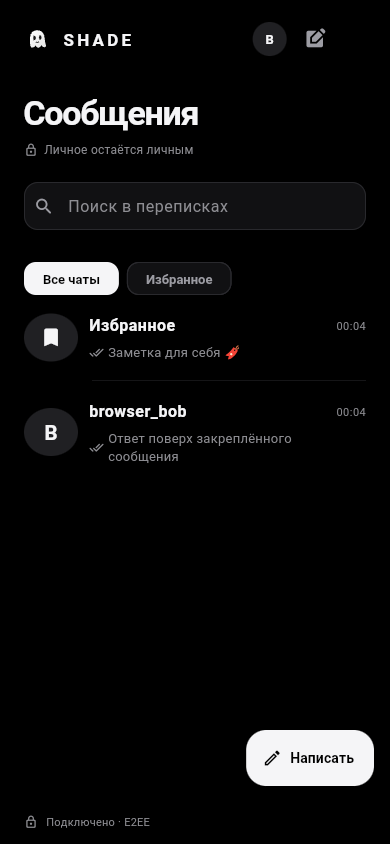
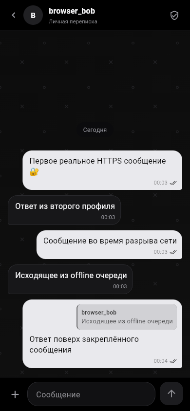
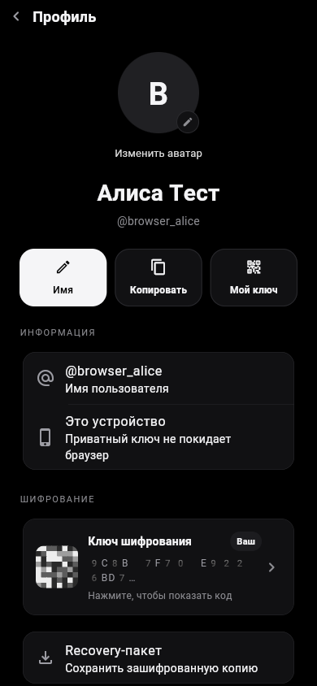

# 🌑 SHADE

**Приватный мессенджер с собственным сервером и сквозным шифрованием (E2EE)**

[](https://flutter.dev/)
[](https://nodejs.org/)
[](https://socket.io/)


> Shade — мессенджер, который я написал с нуля: Android-приложение на Flutter, веб-версия (PWA) и собственный сервер на Node.js. Сообщения шифруются на устройстве отправителя и расшифровываются только на устройстве получателя — сервер видит лишь зашифрованные данные. Проект сделан для хакатона **«ТехноНаставники»** (кейс «Мессенджер», концерн «Созвездие») и живёт дальше: есть рабочий staging и первые реальные тестеры.

**Открытая бета Shade v2:** [открыть в браузере](https://alpha.shadechat.ru/) · [скачать Android-бету для ARM64](https://alpha.shadechat.ru/download/shade-v2-2.1.0-beta.4-arm64.apk).

На новом устройстве можно создать аккаунт через Google или подтвердить подключение с устройства, где Shade уже открыт. Старый сервер v1 закрыт. Аккаунты и история v1 в открытую бету не переносились.

---

## Содержание

- [Что реализовано (по ТЗ кейса)](#-что-реализовано-по-тз-кейса)
- [Бонусы сверх ТЗ](#-бонусы-сверх-тз)
- [Скриншоты](#-скриншоты)
- [Как это устроено](#-как-это-устроено)
- [Как работает шифрование](#-как-работает-шифрование)
- [Стек технологий](#-стек-технологий)
- [Структура проекта](#-структура-проекта)
- [Запуск](#-запуск)
- [Тесты](#-тесты)
- [Честные ограничения](#-честные-ограничения)
- [Команда и материалы кейса](#-команда-и-материалы-кейса)
- [Материалы к защите](#-материалы-к-защите)

---

## ✅ Что реализовано (по ТЗ кейса)

ТЗ кейса описывает типовой стек Kotlin + Firebase. Мой стек (Flutter + собственный сервер на Node.js) был согласован индивидуально, поэтому ниже — **функциональное соответствие**: каждое требование ТЗ закрыто, а принципы клиент-серверного взаимодействия показаны даже глубже, потому что сервер я написал сам, а не взял готовый облачный сервис.

| Требование ТЗ | Как реализовано в Shade | Статус |
| --- | --- | --- |
| Регистрация и вход (email + пароль) | Вход через Google с подтверждённым email. PWA использует локальную фразу для открытия хранилища. Android хранит ключи в зашифрованном хранилище устройства. Фраза восстановления не уходит на сервер. Обработка ошибок: неверный код, занятый nickname, отсутствие ключей на новом устройстве | ✅ работает, проверено в браузерах и на устройствах |
| Список чатов | Экран «Сообщения»: все диалоги, поиск по имени и тексту, фильтр «Избранное», последнее сообщение и время, статусы доставки | ✅ |
| Окно диалога | История сообщений, разделители дат, отправка текста, ответ на сообщение (reply), индикаторы «отправлено / на сервере / доставлено / прочитано» | ✅ |
| Сообщения в реальном времени | Socket.IO-сигналы + подписанный HTTP-fetch (каждые 15 с и после reconnect); сообщение появляется у собеседника без перезагрузки | ✅ |
| Профиль пользователя | Имя, @username, аватар (загрузка и кроп), email из Google, публичный ключ и его отпечаток, список устройств | ✅ |
| Отправка изображений (галерея / камера) | Выбор фото, сжатие, шифрование и отправка чанками; просмотр в чате. На Android — галерея и камера, в PWA — выбор файла/фото | ✅ |
| Индикатор «прочитано» | Двойные галочки: «доставлено» ставится только после подписанного ACK принимающего устройства (расшифровка + атомарное сохранение), «прочитано» — после открытия чата | ✅ |
| Локальное хранение истории | Android: SQLite + SQLCipher (шифрованная база). Web: зашифрованный IndexedDB-vault. История доступна офлайн, переживает перезапуск | ✅ |
| Офлайн-режим | Без сети читается вся история; новые сообщения встают в подписанную очередь (outbox) и доставляются при появлении сети — без повторного шифрования и без дублей | ✅ |
| Сборка APK | `flutter build apk` — инструкция ниже; нативный v2-клиент собран (versionCode 300) и проверен для бесшовного обновления поверх v1 на реальном Samsung | ✅ |
| Исходный код на GitHub | Этот репозиторий | ✅ |
| README с инструкцией и стеком | Этот файл | ✅ |
| Презентация + видеодемонстрация ≤ 7 минут | [Презентация](docs/hackathon/Shade_Защита_ТехноНаставники.pptx), [сценарий видео 1:40](docs/hackathon/DEMO_VIDEO_SCRIPT.md) | ✅ презентация · 🎬 видео — по сценарию до защиты |

## 🎁 Бонусы сверх ТЗ

ТЗ предлагает бонусы по желанию — я закрыл три из пяти и добавил своё:

| Бонус / дополнение | Статус |
| --- | --- |
| **Шифрование** (в ТЗ — симметричное по парольной фразе) | Сделано сильнее: полноценное E2EE — RSA-4096 + AES-256-GCM + подписи RSA-PSS, ключи не покидают устройство |
| **Push-уведомления** | Firebase Cloud Messaging на Android (цепочка клиент→сервер собрана; включается ключом service-account на сервере); в PWA — мгновенные сигналы о новых сообщениях через Socket.IO |
| **Тёмная тема** | AMOLED-чёрная тема — единственная и основная (дизайн в духе Apple × Linear) |
| Индикатор «печатает…» и «в сети» | ✅ (это пункты продвинутого уровня ТЗ) |
| Поиск по чатам и собеседникам | ✅ |
| Мультиустройство (до 8 устройств на аккаунт) | Протокол device-v2: pairing по challenge+proof, подписанные операции |
| Recovery-пакет и вход по биометрии | Зашифрованная резервная копия ключа; на iPhone — разблокировка через Face ID (WebAuthn PRF) |
| Избранное (чат с самим собой), стикеры, ответы на сообщения | ✅ |

## 📸 Скриншоты

Реальные снимки рабочей Web/PWA-версии (тестовые аккаунты, локальный QA-прогон):

| Список чатов | Диалог: статусы, reply, офлайн-очередь |
| --- | --- |
|  |  |

| Профиль: ключ и recovery | Статус «в сети» |
| --- | --- |
|  |  |

Внизу списка чатов видно «Подключено · E2EE» — индикатор живого соединения и режима шифрования. В профиле — отпечаток ключа шифрования и кнопка сохранения recovery-пакета.

## 🧱 Как это устроено

```text
 Android (Flutter)                 Web/PWA (браузер)
 Riverpod, CryptoService           Flutter UI, WebCrypto
 SQLCipher, офлайн-очередь          IndexedDB, офлайн-очередь
               │                       │
               └──── HTTPS / WSS ──────┘
                          │
                    Caddy → alpha.mjs
               device-v2, каталог, ACK
```

Два важных решения, которые я хочу подчеркнуть:

1. **JS владеет ключами, Flutter рисует интерфейс.** В веб-версии криптография и хранение живут в JavaScript (`client/web/alpha-client.mjs`, WebCrypto API), а Flutter собран в web и получает только проекцию данных через мост. Так приватные ключи никогда не попадают в слой UI, а интерфейс при этом общий с Android-приложением — одни и те же виджеты, тема и анимации.
2. **Общий сервер v2.** Android и PWA используют один протокол устройств и собственные локальные хранилища. До 8 устройств на аккаунт, подписанные запросы, подключение нового устройства с подтверждением на уже доверенном.

Сервер пересылает шифротекст и хранит публичные ключи и метаданные доставки. Приватные ключи остаются на устройствах. Веб-клиент зависит от доверенной поставки кода приложения.

## 🔐 Как работает шифрование

Гибридная схема — как в «больших» мессенджерах:

1. При регистрации устройство генерирует отдельные ключи **RSA-4096** для шифрования и подписей. PWA хранит ключи в зашифрованном vault с ключом от парольной фразы (PBKDF2, 600 000 итераций). Android хранит ключи устройства в SQLCipher, ключ базы защищён хранилищем ОС.
2. Для каждого сообщения генерируется случайный **AES-256** ключ и 12-байтный nonce; текст шифруется **AES-256-GCM** (тег аутентификации 16 байт — любая подделка будет обнаружена).
3. AES-ключ + nonce («конверт») шифруются публичным ключом получателя — **RSA-OAEP-SHA256**. Для нескольких устройств получателя конверт делается под каждое устройство.
4. Отправитель подписывает сообщение **RSA-PSS-SHA256** — получатель проверяет, что это именно тот собеседник и что ничего не изменено.
5. Сервер передаёт шифротекст. Получатель расшифровывает конверт своим приватным ключом, затем сообщение — и только после атомарного сохранения в локальную базу отправляет подписанный ACK («доставлено»).

Для ручной проверки контакта можно сверить код безопасности (genesis digest) лично или по другому доверенному каналу. В бете транспорт Android и PWA защищён HTTPS, а каталоги устройств проверяются по подписанной цепочке.

Подробности с листингами — в комментариях к `client/lib/core/services/crypto_service.dart`, `client/web/alpha-client.mjs`, `client/web/protocol/device-v2.mjs`, `server/direct-messaging.js` — прямо в репозитории.

## 🛠️ Стек технологий

| Часть | Технологии | Зачем |
| --- | --- | --- |
| Android-клиент | Flutter / Dart, Riverpod, GoRouter | Один код UI для Android и web, реактивное состояние |
| Web/PWA-ядро | JavaScript (ES modules), WebCrypto API, IndexedDB, Service Worker | Криптография и офлайн-хранилище в браузере, установка «на экран Домой» |
| Сервер | Node.js ≥ 22, Express, Socket.IO | HTTP API + realtime-сигналы, обе версии протокола |
| Криптография | RSA-4096 (OAEP / PSS), AES-256-GCM, PBKDF2, SHA-256 | E2EE, подписи, защита хранилища |
| Хранение на устройстве | SQLite + SQLCipher (Android), IndexedDB + AES-GCM (web), Flutter Secure Storage / Keystore | Шифрованная история и ключи |
| Авторизация | Google OAuth (code flow + PKCE), HttpOnly-cookie, подписи операций устройств | Подтверждённый email без хранения пароля на сервере |
| Push | Firebase Cloud Messaging | Уведомления о новых сообщениях |
| Развёртывание | Docker Compose, Caddy (TLS), systemd, VPS | Production и staging с атомарными релизами и откатом |

## 🗂️ Структура проекта

```text
shade/
├── client/
│   ├── lib/
│   │   ├── core/
│   │   │   ├── database/            # SQLCipher, локальная история
│   │   │   ├── routing/             # навигация (GoRouter)
│   │   │   └── services/            # crypto_service.dart и др.
│   │   ├── features/
│   │   │   ├── auth/                # вход и регистрация
│   │   │   ├── chats/               # диалоги, сообщения, статусы
│   │   │   ├── home/                # список чатов, поиск
│   │   │   ├── profile/             # профиль, аватар, ключи
│   │   │   └── web/                 # Flutter-проекция для PWA (main_alpha.dart)
│   │   └── main_native_v2.dart      # входная точка Android-беты
│   ├── web/                         # JS-ядро PWA
│   │   ├── alpha-client.mjs         # vault, транспорт, outbox, ACK
│   │   ├── protocol/device-v2.mjs   # протокол устройств v2
│   │   └── alpha.html / alpha-ui.mjs
│   ├── tools/build_web_alpha.py     # сборка web-версии
│   ├── android/ ios/ windows/       # платформенные проекты Flutter
│   └── test/                        # unit/UI/крипто-тесты
├── server/
│   ├── server.js                    # relay v1 для локальных регрессионных тестов
│   ├── alpha.mjs                    # сервер открытой беты v2
│   ├── direct-messaging.js          # маршрутизация личных сообщений
│   ├── auth-proof.js / avatars.js / stickers.js
│   └── test/                        # node --test
├── deploy/                          # киты развёртывания (staging/prod)
├── docs/                            # документация, в т.ч. hackathon/
├── docker-compose.yml
└── README.md
```

## 🚀 Запуск

Нужны: **Git, Node.js ≥ 22, Flutter 3.38+** (для Android — Android SDK), Python 3 (для сборки web), Docker — опционально.

### 1. Сервер v1 для локальной проверки совместимости

```bash
cd server
npm ci
# задайте свои DASHBOARD_PASS и SESSION_SECRET (см. .env.example в корне)
npm start
```

Или через Docker из корня: `docker compose up -d --build` (порты 3000/3443, TLS-сертификаты для тестовой среды генерируются скриптом `gen-certs`).

### 2. Сервер v2 для Android и PWA

```bash
cd server
npm ci
# скопируйте deploy/alpha/.env.example в закрытый alpha.env:
# ALPHA_PUBLIC_ORIGIN, Google OAuth client id/secret, storage secret, директория данных
node --env-file=../alpha.env alpha.mjs        # по умолчанию loopback:3101
```

Для входа через Google нужен OAuth-клиент типа Web application и redirect URI `https://<ваш-хост>/auth/google/callback` (для localhost — `http://localhost:3101/auth/google/callback`). Перед Node ставится HTTPS-прокси (пример — `deploy/alpha/Caddyfile.example`). Проверка: `/api/health` → `service=shade-web-alpha, protocol=2`.

### 3. Web-клиент

```bash
python client/tools/build_web_alpha.py   # сборка Flutter UI + JS в client/build/web-alpha
```

Сервер отдаёт собранный клиент сам — откройте `http://localhost:3101` в двух разных браузерных профилях, войдите двумя Google-аккаунтами и переписывайтесь.

### 4. Android-клиент

```bash
cd client
flutter pub get
flutter build apk --release --target lib/main_native_v2.dart --target-platform android-arm64 \
  --dart-define=ALPHA_ORIGIN=https://YOUR_SERVER_HOST \
  --dart-define=ALPHA_GOOGLE_CLIENT_ID=YOUR_WEB_CLIENT_ID
```

Для Android зарегистрируйте OAuth-клиент с идентификатором приложения и SHA-1 сертификата используемой подписи. В параметре `ALPHA_GOOGLE_CLIENT_ID` укажите Web Client ID сервера. Физический телефон должен иметь доступ к указанному адресу по HTTPS.

Подпись релиза — через `client/android/key.properties` (шаблон `key.properties.example`), ключи в Git не коммитятся. Результат: `client/build/app/outputs/flutter-apk/app-release.apk`.

## 🧪 Тесты

```bash
cd server && npm test          # node --test: авторизация, очереди, квитанции, v2-протокол, лимиты
cd client && flutter test      # криптография, UI, ACK, офлайн, interop v1↔v2
cd client && flutter analyze   # статический анализ
```

Последние зафиксированные прогоны (21.11.2026, ветка v2-production): **Flutter 229/229 PASS**, **server 137/137 PASS**, статический анализ без ошибок. Браузерный QA (`server/tools/alpha-browser-qa.mjs`) — Edge (дважды), Edge в «враждебном» режиме и WebKit, два независимых профиля: регистрация, HTTPS/WSS-обмен, расшифровка, ACK, офлайн-очередь, перезагрузка с сохранением ключей, восстановление, подарки стикеров, миграция. Режим «враждебного» QA ломает blob-URL как на реальном Android Chrome, — чтобы тесты не врали.

## ⚠️ Честные ограничения

Я считаю важным говорить, что сделано, а что нет:

- **Forward secrecy (Double Ratchet) пока нет** — сессионные AES-ключи шифруются долговременным RSA-ключом. Это следующий шаг развития криптопротокола.
- **Метаданные видны серверу** (участники, время, размеры) — как и у большинства E2EE-мессенджеров; содержимое — нет.
- **Независимого криптоаудита не было** — используются стандартные примитивы и проверенные библиотеки, но это не сертификация.
- В открытой бете Android работает по v2. Регистрация и подключение нового Android-устройства покрыты локальными тестами. Полный сценарий на двух физических телефонах ещё не подтверждён.
- Минимальная версия Android — API 24 (в ТЗ — API 23): таково требование текущего Flutter; это осознанное и задокументированное отступление.
- История живёт на получивших её устройствах; очистка данных браузера теряет локальную историю (recovery-пакет восстанавливает ключи, но не старую переписку).

## 👥 Команда и материалы кейса

- **Я (школьник)** — вся техническая часть: архитектура, Flutter-клиент, JS-ядро PWA, оба сервера, криптография, тесты, развёртывание и поддержка staging.
- **Ребята из команды** — обсуждение идеи и сценариев, тестирование на своих телефонах, обратная связь по интерфейсу и помощь с подготовкой защиты.
- **Наставник** — консультации по направлению и ревью решений.

Материалы кейса использовал как отправную точку: прошёл дорожную карту «от простого к сложному» (авторизация → список чатов → сообщения → файлы → прочитано → локальное хранение), изучил референсы **ChatterApp** (Kotlin + Compose + Firebase, MVVM) и **Simple Chat** — из них взял структуру фич и подход к разделению UI/данных/логики, но реализовал на своём стеке и со своим сервером. Сравнение с Firebase-подходом — отдельный слайд презентации: кейс просит показать принципы клиент-серверного взаимодействия, и собственный сервер показывает их глубже, чем готовое облако.

## 🎤 Материалы к защите

| Материал | Файл |
| --- | --- |
| Презентация (шаблон ТЗ, ≤ 7 минут) | [docs/hackathon/Shade_Защита_ТехноНаставники.pptx](docs/hackathon/Shade_Защита_ТехноНаставники.pptx) |
| Вопросы жюри и ответы (шпаргалка для репетиции) | [docs/hackathon/DEFENSE_QA.md](docs/hackathon/DEFENSE_QA.md) |
| Сценарий демо-видео 1–2 минуты | [docs/hackathon/DEMO_VIDEO_SCRIPT.md](docs/hackathon/DEMO_VIDEO_SCRIPT.md) |

---

**Автор:** [@kait1x](https://github.com/kait1x) · проект для хакатона «ТехноНаставники», концерн «Созвездие» · 2026